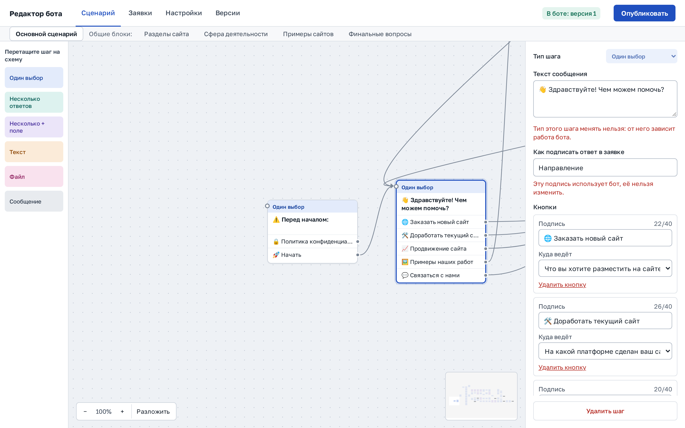
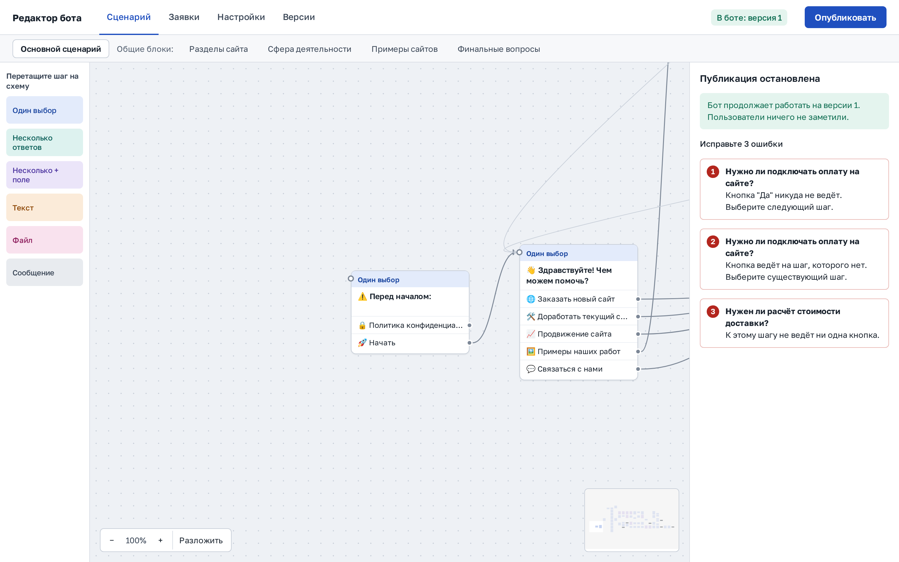
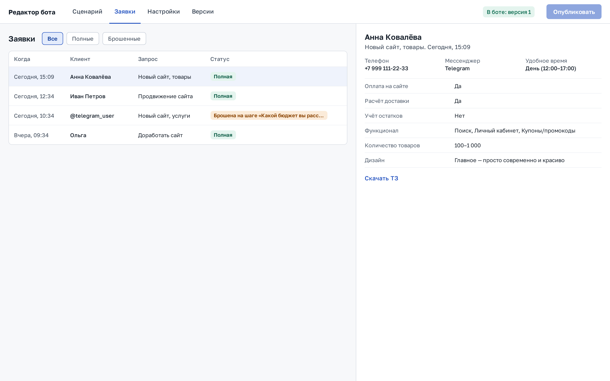

# brief-bot

Telegram-бот, который проводит клиента веб-студии по анкете (заказ сайта, доработка, продвижение) и отправляет заявку менеджеру. К нему визуальный редактор: сценарий бота меняется на схеме без программиста.



## Что умеет

- **Сценарий как данные.** Экраны, кнопки, переходы и условия показа хранятся в базе, бот идёт по этой схеме. После публикации новые диалоги сразу идут по новой версии, начатые анкеты заканчиваются по старой.
- **Визуальный редактор.** Шаги это карточки, переходы это стрелки. Общие блоки (повторяющиеся куски анкеты) выносятся на свои вкладки и вызываются из любого места. Есть отмена (Ctrl+Z), автосохранение черновика и защита от одновременной правки.
- **Проверка при публикации.** Кнопка без перехода, недостижимый шаг, противоречивые условия показа: версия не публикуется, список ошибок ведёт к нужному шагу.
- **Версии.** Каждая публикация сохраняется, любую можно вернуть.
- **Заявки.** Менеджер получает заявку в Telegram-чат, в редакторе есть список заявок с ответами и файлами.
- **Напоминание о брошенной анкете.** Через заданное время бот напоминает клиенту и продолжает с того же места, менеджер получает частичную заявку.
- **Вход в редактор через бота.** Команда `/editor` присылает одноразовую ссылку, первый администратор входит по коду приглашения.

| Ошибки публикации | Заявки |
|---|---|
|  |  |

## Стек

- **Backend:** Python 3.13, aiogram 3, FastAPI, dependency-injector, asyncpg, PostgreSQL 17, Redis 7. Модульный монолит: домены `scenario`, `dialog`, `leads`, `access`, слои endpoint → usecase → service → port ← adapter. Движок диалога чистая функция без ввода-вывода.
- **Редактор:** Nuxt 4, Vue 3, Pinia, Vue Flow, dagre. Слои page → composable → store → repository port ← adapter.
- **Инфраструктура:** Docker Compose, Caddy (HTTPS через Let's Encrypt), опциональный SOCKS5/HTTP-прокси для Telegram.
- **Тесты:** pytest (около 450, включая интеграционные с Postgres и Redis), vitest (около 270).

## Запуск локально

Нужны Docker, [uv](https://docs.astral.sh/uv/) и Node.js 26.

```bash
cp .env.example backend/.env      # вписать токен бота, id чата менеджера, код приглашения
docker compose up -d              # postgres и redis

cd backend
uv sync
uv run uvicorn src.bootstrap.app:app --port 8000   # API и бот, миграции применяются при старте

# во втором терминале
cd editor
npm ci
npm run dev                       # редактор на http://localhost:3000
```

В Telegram отправьте боту `/editor <код приглашения>`: он пришлёт ссылку входа в редактор.

Тесты:

```bash
cd backend && uv run pytest -m "not integration" && uv run ruff check .
cd editor && npm test
```

## Выкладка на сервер

Образы собираются локально и передаются по ssh, исходники на сервер не попадают: `deploy/deploy.sh user@host`. Подробно: [docs/DEPLOY.md](docs/DEPLOY.md).

## Документация

- [docs/services](docs/services): устройство backend по доменам, потоки данных, инварианты, отказы.
- [docs/frontend](docs/frontend): то же для редактора.
