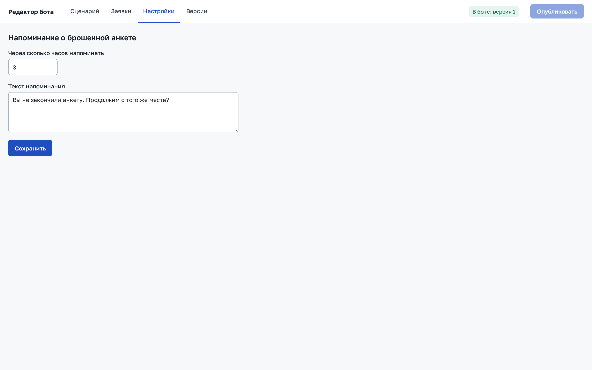
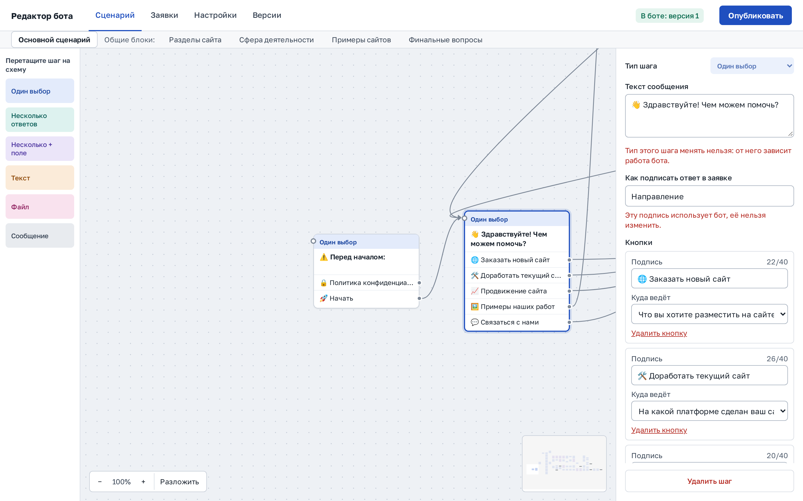
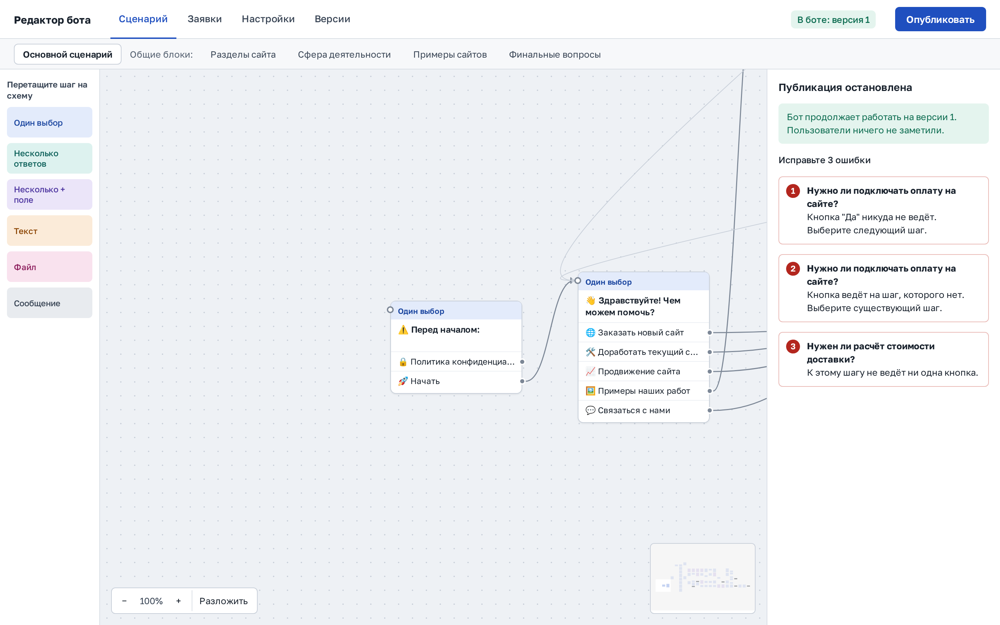
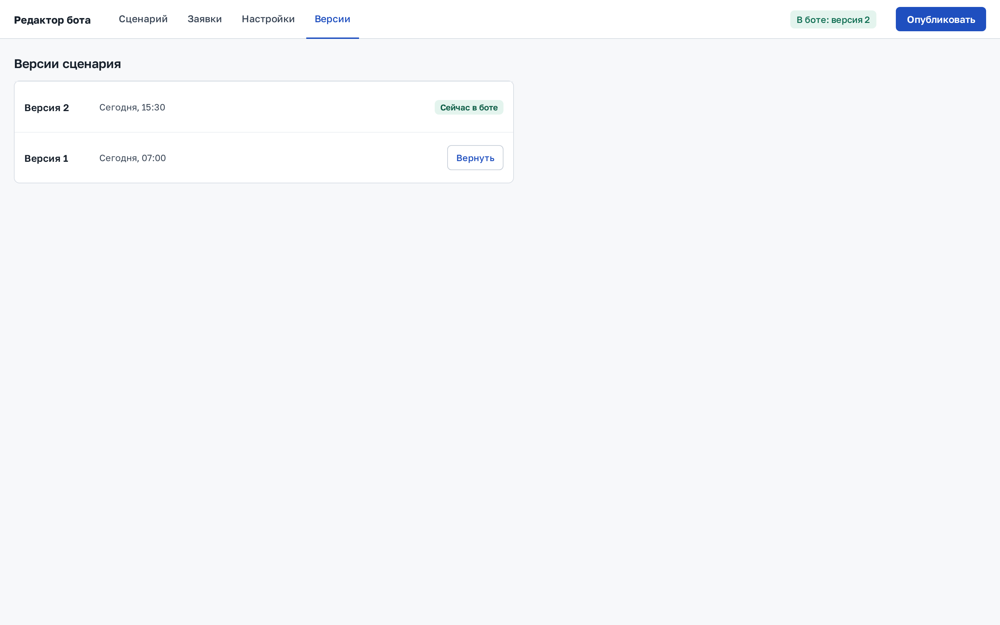
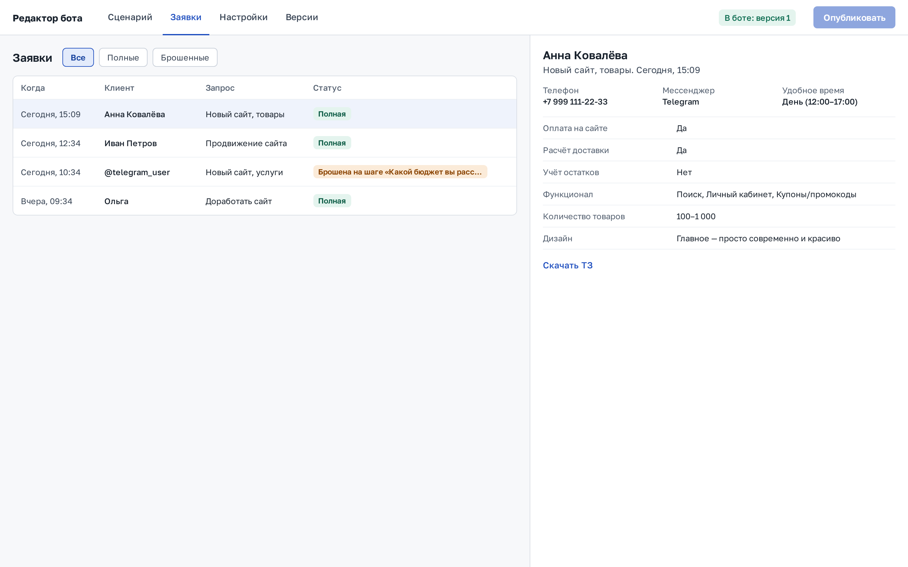

# Отчёт: Telegram-бот для сбора брифа и редактор сценария

Здравствуйте. Я сделал Telegram-бота, который проводит клиента по анкете из вашего PDF и отправляет заявку менеджеру. К нему я добавил редактор: в нём вы сами меняете тексты, кнопки и порядок вопросов, без программиста. Ниже всё по пунктам задания.

## 1. Ссылка и демонстрация

- Бот: [ССЫЛКА НА БОТА]
- Редактор: [ССЫЛКА НА РЕДАКТОР]

Бот работает на моём сервере на период проверки. Заявки приходят в тестовый чат, контакты в сценарии (`@11111`, телефон, почта) и ссылки на примеры работ пока заглушки. Вы замените их в редакторе.

Снимки бота: [СНИМКИ БОТА]

Снимки редактора лежат в `screens/`. На них пример заявок и версий, настоящих заявок там нет.

## 2. Платформа и технология

Собственное решение. Бот написан на Python (aiogram), редактор на Nuxt и Vue Flow, серверная часть на FastAPI. Данные лежат в PostgreSQL, временное состояние анкеты в Redis.

Главное решение: сценарий хранится как данные, а не как код. Каждый экран бота, каждая кнопка и каждый переход записаны в базе в виде схемы, и бот идёт по этой схеме. Поэтому, когда вы меняете схему в редакторе и нажимаете "Опубликовать", новые диалоги сразу идут по новой версии, без доработки и перезапуска. Клиент, который уже начал анкету, спокойно закончит её по прежней версии.

Анкета из PDF перенесена целиком: 70 экранов и 257 кнопок. В PDF 429 кнопок: 57 из них "Назад", бот добавляет эту кнопку сам. Остальная разница это повторы одних и тех же блоков (сфера деятельности, разделы сайта, примеры сайтов, финал). Они собраны в общие блоки и записаны один раз.

### Что я исправил в сценарии

Сначала три решения, которые мы согласовали:

- Блок "Спорт / отдых / тренеры" был скопирован с текста про еду и повторялся дважды. Оставлен один, с текстом про спорт и отдых.
- Условие "первые 5 ответов" понято как "человек уже что-то продвигает".
- Вместо "чтобы я проанализировала" теперь "мы".

Решения, которые принял я:

1. Новый сайт, ответ "Иное": в PDF после него ничего не было. Теперь после ввода текста идёт конец ветки "Услуги", вопрос о сфере не задаётся.
2. Продвижение, "Оставьте ссылку на сайт": вопрос дублировал первый и не имел смысла при "Пока нет сайта". Теперь он показывается, только если ссылку ещё не вводили и выбран не этот вариант.
3. "Никогда не продвигали" и "Затрудняюсь": как в PDF, ведут сразу к финалу. Эти ответы нельзя отметить вместе с другими.
4. То же правило для "Нет" в вариациях товаров, "Пока нет сайта и других каналов", "Нет, никогда не обращались", "Нет, пока не продвигаем".
5. "Что будет приоритетом?" и шаги продвижения были без кнопки "Назад". Теперь она есть.
6. Опечатки: "в каком формат" стало "в каком формате", "я пришлю" стало "мы пришлём".
7. "Создать новый сайт", "Заказать новый сайт" и "Заказать сайт": теперь везде "Заказать новый сайт".
8. Политика конфиденциальности: в PDF не было ссылки. Сделана кнопка со ссылкой-заглушкой, адрес меняется в редакторе.
9. Длинные подписи кнопок обрезаются на телефоне. Подписи сокращены до 40 знаков, смысл перенесён в текст вопроса.
10. Ветка "Услуги": вопроса о дизайне нет, как в PDF. Он есть только у "Товаров" и "Товаров и услуг".
11. Эмодзи в PDF отображались сломанными, я подобрал их по смыслу.

Правки, которые пришлось сделать из-за устройства Telegram и самой схемы:

- Поле ввода и кнопки не бывают на одном экране. Поэтому после кнопки "Иное" текст запрашивается отдельным экраном. В PDF такого экрана нет, я дописал короткие просьбы, например "Напишите, что ещё хотите доработать:".
- В доработке сайта экран со ссылкой разделён на два: сначала кнопки "Ввести ссылку", "Не помню ссылку, нужна помощь", "Сайт не открывается, нужна помощь", затем поле ввода.
- После "Иное" в примерах работ добавлено короткое сообщение "Спасибо! Если в портфолио есть подходящие сайты, мы пришлём их вам."
- "Спасибо! Переходим к следующему вопросу." показывается один раз за анкету. Для этого вопрос "Есть ли пример сайта, который вам нравится?" в ветке "Услуги" существует отдельной копией. Если будете менять его текст, правьте его в обоих местах: в ветке "Услуги" и в общем блоке "Примеры сайтов".
- Кнопка "Назад" есть на каждом экране, кроме первого экрана, главного меню и финала. Если клиент пришёл в примеры работ или "Связаться" кнопками под благодарностью, "Назад" ведёт в главное меню.
- "(мультивыбор)" заменено на "Можно выбрать несколько".
- "Доработать сайт" на экране "Связаться" названо "Доработать текущий сайт", как в главном меню.
- Кнопки под благодарностью ("Вернуться в главное меню", "Примеры наших работ", "Связаться напрямую") работают и начинают новый проход.

## 3. Дополнительная функция: напоминание о брошенной анкете

Если клиент начал анкету и замолчал, бот напоминает о ней сам.

- Когда: через 3 часа после его последнего ответа. Срок отсчитывается от каждого нового ответа.
- Что видит клиент: сообщение "Вы не закончили анкету. Продолжим с того же места?" и две кнопки, "Продолжить" и "Начать заново".
- Что получает менеджер: частичную заявку. В ней направление, Telegram клиента, шаг, на котором он остановился, и всё, что он успел ответить. Менеджер получит её, даже если клиент заблокировал бота.
- Условия: напоминание приходит один раз за анкету. Если клиент ответил только на выбор направления или уже дошёл до финала, ничего не отправляется.
- Если клиент потом закончит анкету, частичная заявка станет полной, менеджер получит полную версию.
- Где менять: в редакторе, вкладка "Настройки". Срок от 1 до 168 часов и текст сообщения. Новый срок действует со следующего ответа клиента, публиковать сценарий не нужно.

## 4. Администрирование

Всё, что вы делаете сами, вы делаете в редакторе.

Вход: отправьте боту команду `/editor [КОД ПРИГЛАШЕНИЯ]`. Код нужен один раз, он делает вас администратором. После этого достаточно `/editor`. Бот присылает ссылку, она одноразовая и действует 10 минут. После входа редактор открыт 24 часа.

В редакторе четыре вкладки.

**Сценарий.** Схема всей анкеты: шаги как карточки, переходы как стрелки. Нажмите на шаг, справа откроется панель. В ней вы меняете текст вопроса, подписи кнопок, переходы и условия показа, добавляете и удаляете кнопки. Новый шаг перетаскивается на схему из палитры, стрелка от кнопки к шагу задаёт переход. Общие блоки открываются вкладками над схемой. Правки сохраняются сами, но бот работает по старой версии, пока вы не нажмёте "Опубликовать".

**Публикация.** Кнопка "Опубликовать" проверяет сценарий. Если в нём ошибка (кнопка без перехода, шаг, до которого не дойти), версия не публикуется, а справа появляется список ошибок. Нажатие на ошибку открывает нужный шаг. Бот в это время работает на прежней версии, клиенты ничего не замечают.

**Версии.** Каждая публикация сохраняется. Любую прежнюю версию можно вернуть кнопкой "Вернуть".

**Заявки.** Список всех заявок, полных и брошенных, с фильтром. В карточке видны ответы клиента, а если он прислал файл с ТЗ, его можно скачать.

**Настройки.** Срок и текст напоминания, см. пункт 3.

Защита от случайных ошибок:

- Подписи ответов "Имя" и "Направление" использует сам бот ("Спасибо за заявку, Анна!", направление в заявке). Их нельзя переименовать или занять, а тип таких шагов не меняется.
- Первый шаг сценария удалить нельзя.
- Если шаг ни с чем не связан, панель сообщает: "Шаг пока не подключён. Бот его не покажет."

Чат менеджеров в редакторе не настраивается: он задан на сервере, чтобы заявки не ушли не туда по случайной правке.

Сами вы не меняете токен бота, чат менеджеров и настройки сервера. Всё остальное, от текстов до напоминания, меняется в редакторе.

## 5. Фактический срок

[ЧАСЫ]

## 6. Стоимость использования

Единственный регулярный расход: сервер (VPS), 300-600 ₽ в месяц в зависимости от провайдера. Платы за платформу и абонентской платы нет. Telegram-бот, база данных, редактор и сертификат для адреса редактора бесплатны, домен покупать не нужно.

## 7. Стоимость разработки для реального заказчика

[СТОИМОСТЬ]
